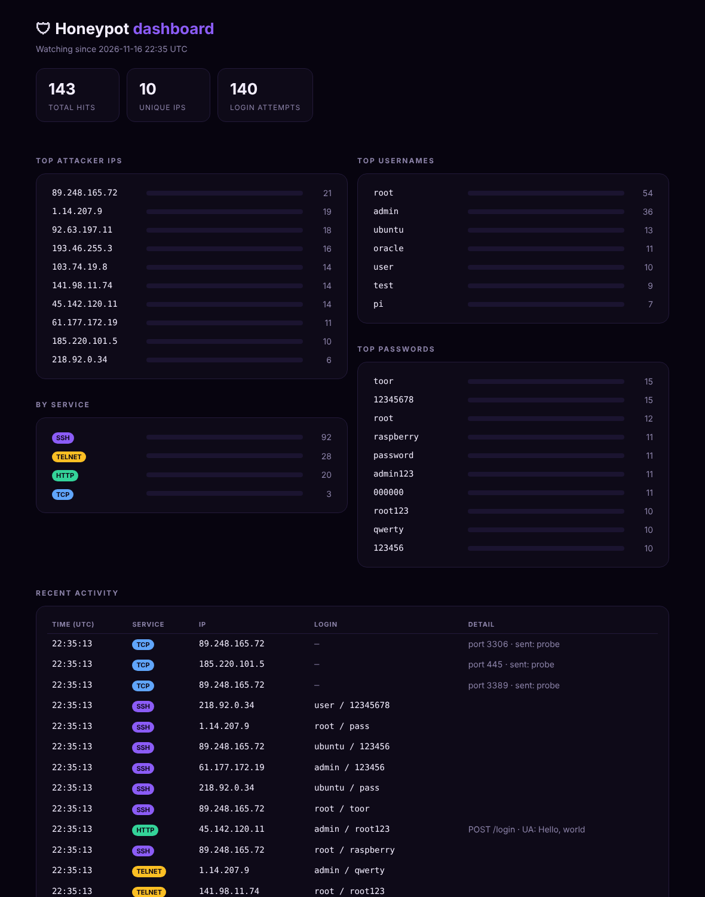

<div align="center">

# 🛡️ Honeypot

**A low-interaction honeypot that emulates SSH, Telnet and a web admin login, logs every intrusion attempt (IP, usernames, passwords), alerts you on Telegram, and shows it all on a live dashboard.**




</div>

> ⚠️ **Only run this on a network and host you own, and keep it isolated.** A honeypot deliberately invites attackers. This one is **low-interaction** — it emulates services and logs attempts but never gives anyone a real shell or runs anything they send — so there's nothing to actually break into. Still, don't run it on a machine that holds anything important, and never point it at a network you don't control.

---

## What it does

- **Fake SSH** (paramiko): presents a real SSH handshake, captures every username/password tried, and always rejects the login.
- **Fake Telnet**: shows a login prompt and logs what's entered.
- **Fake web admin login**: serves a convincing router-admin page and logs every submitted credential and request.
- **Catch-all TCP ports**: watches extra ports (RDP, SMB, MySQL, Postgres…) and logs the connection plus the first bytes sent — perfect for spotting scanners.
- **Telegram alerts**: pings you on each hit, throttled per-IP so a hammering bot can't spam you.
- **Live dashboard**: top attacker IPs, top usernames and passwords, hits by service, and a recent-activity feed — dark themed, auto-refreshing, read-only.

Everything is logged to `data/events.jsonl` (one JSON object per hit) and `data/events.db` (SQLite).

## Quick start

```bash
pip install -r requirements.txt
python honeypot_main.py
```

On Windows, double-click **`Run honeypot.bat`**. Then open the dashboard at **http://127.0.0.1:8888**.

By default the honeypots listen on **high ports** (SSH 2222, Telnet 2323, HTTP 8080) so you don't need admin rights. Test it:

```bash
ssh -p 2222 root@localhost          # type any password — watch it appear on the dashboard
curl http://localhost:8080          # the fake admin page
```

## Catching real attackers

A honeypot only sees real traffic if attackers can reach it. Two ways:

- **On your homelab (recommended):** run it on your ZimaOS box and map the real ports to it.
  1. Put this folder at `/DATA/AppData/honeypot` (with your `config.toml` + `.env`).
  2. ZimaOS App Store → **+** → Custom Install → Import → paste `docker-compose.yml`.
  3. It maps real **22 → 2222**, **23 → 2323**, **80 → 8080** inside the container.
- **Expose to the internet (advanced, optional):** forward a port on your router to the honeypot. Within hours you'll see real bots trying `root/root`, `admin/admin`, and the like. **Only do this on an isolated host** — a cheap VPS or a VLAN'd box, never your main PC.

> On a home network, the real value is as a **tripwire**: nothing legitimate should ever connect to these fake services, so any hit means something worth looking at — a device scanning your network, or someone on your Wi-Fi who shouldn't be.

## Configuration

Copy `config.example.toml` to `config.toml`:

| Setting | Meaning |
|---|---|
| `[services]` | which fake services to run and on which ports |
| `extra_tcp_ports` | other ports to watch as catch-all loggers |
| `[dashboard]` host/port | the dashboard is `127.0.0.1` (localhost) only by default |
| `[telegram] per_ip_cooldown_seconds` | minimum gap between alerts from the same IP |

Telegram alerts (optional): copy `.env.example` to `.env` and add a bot token + chat id. Leave it blank to just log to disk and the dashboard.

## Project layout

```
honeypot/
├── honeypot_main.py        # starts the listeners + dashboard
├── honeypot/
│   ├── store.py            # JSONL + SQLite logging and queries
│   ├── notify.py           # Telegram alerts (per-IP throttled)
│   ├── dashboard.py        # the live dashboard
│   └── services/
│       ├── ssh.py          # paramiko SSH honeypot (captures creds)
│       ├── http.py         # fake admin login
│       ├── telnet.py       # telnet login prompt
│       └── generic.py      # catch-all TCP logger
├── docker-compose.yml      # ZimaOS / Docker deploy
└── tests/                  # offline tests (no real listeners)
```

## Safety recap

- Low-interaction: no shell, no code execution, nothing to compromise.
- Runs isolated (its own container) so a probe can't reach the rest of your network.
- The dashboard binds to localhost; don't expose it publicly.
- Captured passwords are other people's guesses against a fake service — but still treat `data/` as sensitive and keep it out of git (it already is).

## License

[MIT](LICENSE)

<div align="center"><sub>Built by <a href="https://github.com/trainormailloux">Trainor Mailloux</a> · Cybersecurity @ Merrimack College</sub></div>
